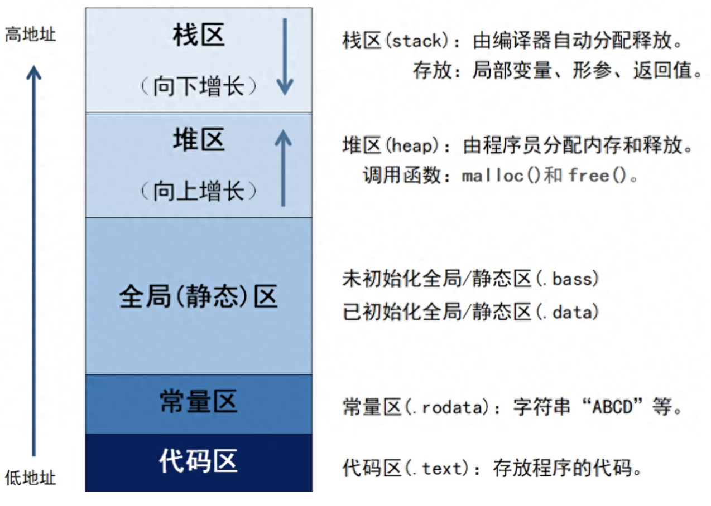

## C语言内存分区
C语言内存分区(Memory Setments)示意图如下：


>链接： http://www.cnblogs.com/xiaohuang/p/10216505.html

详细代码见 `./ds_proj/c/test_segments.c`

### 栈区
栈区由编译器自动分配释放，由操作系统自动管理，无须手动管理。
栈区上的内容只在函数范围内存在，当函数运行结束，这些内容也会自动被销毁。
栈区按内存地址由高到低方向生长，其最大大小由编译时确定，速度快，但自由性差，最大空间不大。
栈区是先进后出原则，即先进去的被堵在屋里的最里面，后进去的在门口，释放的时候门口的先出去。
**存放内容**
临时创建的局部变量和const定义的局部变量存放在栈区。
函数调用和返回时，其入口参数和返回值存放在栈区。

### 堆区
堆区由程序员分配内存和释放。
堆区按内存地址由低到高方向生长，其大小由系统内存/虚拟内存上限决定，速度较慢，但自由性大，可用空间大。
调用函数用malloc等函数实现动态分布内存。
```c
#include <stdlib.h>
void *malloc(size_t size); //返回void *类型的指针，该指针指向指向分配空间的首地址
void free(void *ptr);  //用完一定要释放，否则会造成内存泄漏
```
### 全局（静态）区
通常是用于那些在编译期间就能确定存储大小的变量的存储区，但它用于的是在整个程序运行期间都可见的**全局变量和静态变量**。
全局区有 .bss段 和 .data段组成。
#### .bss段
未初始化的**全局变量**和未初始化的**静态变量**存放在.bss段；
初始化为0的全局变量和初始化为0 的静态变量存放在.bss段；
.bss段可读可写。
.bss段不占用可执行文件空间，其内容由操作系统初始化。
#### .data段
已初始化的全局变量和已初始化的静态变量存放在.data段；
.data段占用可执行文件空间，其内容由程序初始化。
.data段是可读可写。
### 常量区 (.rodata段)
字符串、数字等常量存放在常量区；
const修饰的全局变量存放在常量区；
程序运行期间，常量区的内容不能被修改。
### 代码区（.text段）
程序执行代码存放在代码区，其值不能被修改。
字符串常量和define定义的常量也有可能存放在代码区

### 既然.bss段和.data段都是可读可写的，那么.bss段和.data段有什么区别呢？
既然两者运行时都可读写，区分的动机不在"运行时权限"，而在文件存储与加载效率。关键差异是：
> .data 存的是"有非零初值"的变量，初值必须写进可执行文件；.bss 存的是"初值为 0 或未初始化"的变量，不需要在文件里存任何初值，加载时清零即可。
1. 最直接的例子：一个大数组
```c
int big_zero[1000000];      // 未初始化 → 全 0 → 放 .bss
int big_one[1000000] = {1}; // 首元素 1，其余 0 → 放 .data
```
- big_zero：100 万个 int = 4 MB，但初值全是 0。如果放进 .data，可执行文件要白白多 4 MB 的全零字节。
- .bss 的做法：文件里只记录"需要 4 MB 的零初始化空间"这一个大小信息，不存实际字节。加载时 OS 把这块内存映射成零页（或清零），文件体积几乎不增加。
同理 big_one 虽然 99.9999% 是 0，但因为有非零初值，标准做法是整体放 .data，文件里要存 4 MB（优化器可能特殊处理，但概念上如此）。
这就是 .bss 存在的第一目的：避免在可执行文件里存储大量零字节。
2. 加载过程也体现了区别
.data：程序启动时，加载器把文件里 .data 段的内容拷贝到内存的 RW 段（因为初值非零，必须从文件读）。
.bss：文件里没有内容，加载器只需在内存里预留大小并清零（现代 OS 用"零页"映射，连清零都省了，写时复制）。
所以 .bss 不仅省文件空间，还省 I/O——不需要从磁盘读那几 MB 的零。
3. 一个常被忽略的细节：未初始化 ≠ 一定是 0？
C 标准说：
静态存储期对象（全局、static 局部）未显式初始化时，保证初值为 0（6.7.9）。所以 int g; 在全局/static 语境下等价于 int g = 0;，放 .bss 完全正确。
自动存储期对象（普通局部变量）未初始化时是不确定值，在栈上，与 .bss/.data 无关。
所以"未初始化"进 .bss 只针对静态存储期变量，且语义上它们确实就是 0。

4. 补充：const 全局变量去哪
const int g = 42; 通常进 .rodata（只读数据段），既不是 .data 也不是 .bss——因为它不可写，加载到 r-- 页。这也说明"段"的划分不仅看"有无初值"，还看"是否可写"。

**小结**
区分 .bss 和 .data 的目的不是运行时权限（两者都可读写），而是可执行文件的存储效率：
.data 存非零初值，初值必须写进文件；
.bss 存零初值/未初始化，文件里只记大小，加载时清零。
这样大量零初始化变量不会让可执行文件膨胀，也省去加载时的无谓 I/O。全放 .data 会浪费文件和加载时间；全放 .bss 又无法表示非零初值——所以必须分开。

**对比表**
|特性|	.data|	.bss|
|:--:|:--:|:--:|
|存什么|	有非零初值的全局/静态变量	|初值为 0 或未初始化的全局/静态变量|
|文件里是否占空间|	✅ 占（初值要写进文件）|	❌ 不占（只记大小）|
加载时	|从文件读入内存|	OS 分配零页 / 清零|
运行时权限|	rw-|	rw-|
典型例子|	int g = 42; char s[] = "hi";|	int g; static int arr[1000];|

## STM32存储器分配
RAM：主存，或内存，与CPU直接交换数据的内部存储器。可以随时读写。
ROM：只读存储器，与CPU不直接交换数据，只能被CPU读取。
STM32F03芯片
全局（静态）区、堆区、栈区在RAM中，
常量区、代码区在ROM中


## objdump 的作用
能看到.text和.bss等段的“地址范围”和“用途”，但看不到“运行时的内存”（栈、堆）的实际内容。
objdump是静态分析工具，它分析的是可执行文件本身，不是运行时的内存状态。

## objdump -d test_stack2
`objdump -d`的结果，它只反汇编了代码段，没有显示数据段。
```text
Disassembly of section .init:      ← 初始化代码
Disassembly of section .plt:       ← 动态链接跳转表
Disassembly of section .plt.got:   ← GOT 相关跳转
Disassembly of section .text:      ← 主代码段（你的程序）
Disassembly of section .fini:      ← 终止代码
```

### .text(代码段)-能看到
```asm
0000000000001129 <add>:             ← add 函数在 .text 段
    1129: f3 0f 1e fa   endbr64
    ...

0000000000001141 <main>:            ← main 函数在 .text 段
    1141: f3 0f 1e fa   endbr64
    ...
```
### .bss(未初始化数据段) - 能看到地址，看不到内容
存放**未初始化或初始化为0**的全局/静态变量。
```c
int global_var;              // .bss
static int static_var;       // .bss
int arr[1000];               // .bss
```
`objdump -d`只反汇编代码段，不显示`.bss`段。但能从代码里间接看到`.bss`的地址。
```asm
    1070:	48 8d 3d 99 2f 00 00 	lea    0x2f99(%rip),%rdi        # 4010 <__TMC_END__>
    1077:	48 8d 05 92 2f 00 00 	lea    0x2f92(%rip),%rax        # 4010 <__TMC_END__>
```
4010 就是 .bss 段的一个地址（__TMC_END__ 标记）。

查看`.bss`的完整方法
```bash
# 查看所有段的信息
objdump -h test_stack2

# 或
readelf -S test_stack2
```

# 查看 .bss 段的原始内容
```bash
objdump -s -j .bss test_stack2  //-s 显示段内容，-j .data 指定段名。
```
输出内容：
```text
test_stack2:     file format elf64-x86-64

Contents of section .data:
 4000 00000000 00000000 08400000 00000000  .........@......
```

### .data(初始化数据段) - 能看到地址，内容

### .rodata(只读数据段) - 能看到地址，内容
存放只读数据，如字符串常量。
查看方法：
```bash
objdump -s -j .rodata test_stack2  //-j <area> 是过滤器，可以配合 -d 或 -s 使用，用来限定只显示某个段。
```
### 完整段布局（运行时）
```text
高地址
+------------------+
|  栈（Stack）      |  ← 运行时由内核创建，向低地址增长
|  ...             |
+------------------+
|  ...             |
+------------------+
|  堆（Heap）       |  ← 运行时由 malloc 分配，向高地址增长
|  ...             |
+------------------+
|  .bss            |  ← 未初始化数据（objdump 可见）
+------------------+
|  .data           |  ← 已初始化数据（objdump 可见）
+------------------+
|  .rodata         |  ← 只读数据（objdump 可见）
+------------------+
|  .text           |  ← 代码（objdump 可见）
+------------------+
|  .init / .fini   |  ← 初始化/终止代码（objdump 可见）
+------------------+
低地址
```
例子:
|const| 变量定义|	存储区|	说明|
|----|----|----|----|
|全局 |const（已初始化）|	.rodata|	只读数据段|
|全局 |const（未初始化）|	.bss（但值为 0，只读）|	少见|
|局部| const（函数内）|	栈	|和普通局部变量一样|
|局部 |static const	|.rodata	|静态存储，只读|
|const |指针指向的字符串字面量|	.rodata	|如 const char *p = "hello"|

## 运行时地址
`objdump -d test_stack2`生成的.text段中指令地址为0x1141的理解。

**不完全是偏移量。`0x1141` 是链接时确定的「虚拟地址（VMA）」，但程序实际运行时，地址被 ASLR（地址空间布局随机化）加了一个随机基址，变成了 `0x7f555555555141` 这类地址。**

用公式表示：

```
运行时地址 = 随机基址 + 链接时虚拟地址
0x7f555555555141 = 随机基址 + 0x1141
```

所以：
- **`0x1141` 是"链接时虚拟地址"**（link-time VMA），不是偏移量
- **偏移量**是相对于**段起始地址**的偏移
- **运行时地址** = 加载基址 + 链接时虚拟地址

---

### 二、三个概念区分

| 概念 | 含义 | 你的例子 |
|------|------|---------|
| **文件偏移（File Offset）** | 指令在**可执行文件**中的位置 | 比如 `0x1141`（假设） |
| **链接时虚拟地址（VMA）** | 链接器分配的**运行时虚拟地址** | `0x1141` |
| **运行时地址（Runtime Address）** | 程序实际加载到的虚拟地址 | `0x7f555555555141` |

**关键**：在典型的 Linux 可执行文件中，**文件偏移和 VMA 往往数值相同**（因为代码段通常从 `0x1000` 开始映射），但它们的概念完全不同。

---

### 三、用 `readelf` 查看真实布局

```bash
readelf -S test_stack2 | head -30
```

输出示例：
```
Section Headers:
  [Nr] Name              Type             Address           Offset
       Size              EntSize          Flags  Link  Info  Align
  [ 0]                   NULL             0000000000000000  00000000
  ...
  [13] .text             PROGBITS         0000000000001040  00001040
       0000000000000161  0000000000000000  AX       0     0     16
  ...
```

**关键字段**：

| 字段 | 值 | 含义 |
|------|-----|------|
| `Address` | `0x1040` | `.text` 段的**链接时虚拟地址（VMA）** |
| `Offset` | `0x1040` | `.text` 段在文件中的**偏移** |
| `Size` | `0x161` | 段大小 |

**`main` 在 `.text` 段内**：
- `.text` 段 VMA = `0x1040`
- `main` 在 `.text` 中的偏移 = `0x1141 - 0x1040 = 0x101`
- `main` 的 VMA = `0x1040 + 0x101 = 0x1141`

---

### 四、为什么运行时地址不同？

### ASLR（地址空间布局随机化）

现代操作系统默认开启 ASLR，每次运行程序时，**加载基址是随机的**：

```
加载基址 = 随机值（比如 0x7f555555400000）
```

**运行时地址计算**：
```
运行时地址 = 加载基址 + 链接时 VMA
0x7f555555555141 = 0x7f555555400000 + 0x1141
```

### 验证 ASLR

```bash
# 连续运行两次，看地址是否不同
$ lldb test_stack2
(lldb) b main
(lldb) run
(lldb) register read rip
     rip = 0x7f555555555141   ← 第一次

$ lldb test_stack2
(lldb) b main
(lldb) run
(lldb) register read rip
     rip = 0x7f123456785141   ← 第二次（不同）
```

**每次运行地址都不同**，这就是 ASLR 的效果。

### 关闭 ASLR

```bash
# 临时关闭（需要 sudo）
sudo sysctl -w kernel.randomize_va_space=0

# 或在 GDB 中关闭
(gdb) set disable-randomization on
```

关闭后，每次运行的加载基址固定，运行时地址就一致了。

---

### 五、PIE 可执行文件

现代 Linux 的可执行文件默认是 **PIE（Position Independent Executable，位置无关可执行文件）**。

### PIE 的特点

| 特性 | 非 PIE | PIE |
|------|--------|-----|
| 链接时 VMA | 固定（如 `0x400000`） | 相对（如 `0x0`） |
| 加载基址 | 固定 | 随机（ASLR） |
| 运行时地址 | = VMA | = 随机基址 + VMA |
| 安全性 | 低 | 高（防攻击） |

**你的 `test_stack2` 是 PIE**：
```bash
$ file test_stack2
test_stack2: ELF 64-bit LSB pie executable, x86-64, ...
```

**注意**：`pie executable` 说明是 PIE。

### 查看加载基址

```bash
# 运行时查看进程的内存映射
$ ./test_stack2 &
$ cat /proc/$!/maps | head
555555554000-555555555000 r--p 00000000 ...  test_stack2
555555555000-555555556000 r-xp 00001000 ...  test_stack2   ← .text
555555556000-555555557000 r--p 00002000 ...  test_stack2   ← .rodata
...
```

**`555555555000`** 就是 `.text` 段的运行时起始地址。

**`main` 的运行时地址**：
```
0x555555555000 + 0x141 = 0x555555555141
```

**注意**：你的 LLDB 显示的是 `0x7f555555555141`，和 `/proc/pid/maps` 里的 `0x555555555141` 不同。这是因为：
- **ASLR 每次运行的基址不同**
- LLDB 的显示取决于当前进程的加载基址

---

### 六、图解地址计算

### 链接时（objdump 显示）

```
链接时虚拟地址空间：
+------------------+  ← 0x0
|  ...             |
+------------------+  ← 0x1040
|  .text           |
|  ...             |
|  main at 0x1141  |  ← 链接时 VMA
|  ...             |
+------------------+  ← 0x1040 + 0x161 = 0x11a1
```

### 运行时（PIE + ASLR）

```
运行时虚拟地址空间：
+------------------+  ← 0x555555554000（加载基址，随机）
|  ...             |
+------------------+  ← 0x555555555040
|  .text           |
|  ...             |
|  main at 0x555555555141  |  ← 运行时地址
|  ...             |
+------------------+  ← 0x5555555551a1
```

**计算公式**：
```
运行时地址 = 加载基址 + 链接时 VMA
0x555555555141 = 0x555555554000 + 0x1141
```

---

### 七、非 PIE 的情况

如果编译时加 `-no-pie`：

```bash
gcc -no-pie test.c -o test
```

**结果**：
- 链接时 VMA = 运行时地址
- `main` 始终在 `0x401141` 之类**固定**地址
- ASLR 不影响代码段（但仍影响栈、堆、库）

**验证**：
```bash
$ file test
test: ELF 64-bit LSB executable, x86-64, ...   ← 没有 "pie"
```

**objdump 输出**：
```asm
0000000000401141 <main>:    ← 固定的 0x401141
```

**运行时**：
```bash
$ lldb test
(lldb) b main
(lldb) run
(lldb) register read rip
     rip = 0x401141    ← 和 objdump 一致
```

---

### 八、总结

| 问题 | 答案 |
|------|------|
| `0x1141` 是偏移量吗？ | ❌ 是**链接时虚拟地址（VMA）** |
| 为什么运行时地址不同？ | ASLR 给程序加了随机加载基址 |
| 运行时地址公式？ | `运行时地址 = 加载基址 + 链接时 VMA` |
| `0x1141` 和文件偏移一样吗？ | 在 Linux 可执行文件中**数值往往相同**，但概念不同 |
| 为什么是 PIE？ | 现代 Linux 默认编译为 PIE，支持 ASLR |
| 怎么固定地址？ | 编译时加 `-no-pie` |
| 怎么关闭 ASLR？ | `sudo sysctl -w kernel.randomize_va_space=0` |

**核心理解**：
- **`objdump` 显示的是"链接时虚拟地址（VMA）"**
- **运行时地址 = 加载基址 + VMA**
- **PIE + ASLR** 让加载基址每次随机
- **非 PIE** 时，VMA = 运行时地址

**类比**：
> `0x1141` 像"书里第 1141 页的页码"。
> 加载基址像"这本书被放在书架的哪个位置"。
> 运行时地址像"从书架位置 + 页码算出的实际位置"。
> ASLR 让每次放书的位置都不同，所以实际位置也不同。

**验证命令**：
```bash
# 查看段布局
readelf -S test_stack2

# 查看加载基址
cat /proc/$(pgrep test_stack2)/maps

# 查看是否为 PIE
file test_stack2
```

### 实际测试
在一个终端中执行`lldb test_stack2， b main, run 12 34`停止
在另一个终端中执行`cat /proc/$(pgrep test_stack2)/maps`查看加载基址
$ cat /proc/$(pgrep test_stack2)/maps
555555554000-555555555000 r--p 00000000 08:03 131268                     /home/wenyuc/work/c_proj/test_stack2
555555555000-555555556000 r-xp 00001000 08:03 131268                     /home/wenyuc/work/c_proj/test_stack2
555555556000-555555557000 r--p 00002000 08:03 131268                     /home/wenyuc/work/c_proj/test_stack2
555555557000-555555559000 rw-p 00002000 08:03 131268                     /home/wenyuc/work/c_proj/test_stack2
7ffff7fbf000-7ffff7fc3000 r--p 00000000 00:00 0                          [vvar]
7ffff7fc3000-7ffff7fc5000 r-xp 00000000 00:00 0                          [vdso]
7ffff7fc5000-7ffff7fc6000 r--p 00000000 08:03 93415                      /usr/lib/x86_64-linux-gnu/ld-linux-x86-64.so.2
7ffff7fc6000-7ffff7ff1000 r-xp 00001000 08:03 93415                      /usr/lib/x86_64-linux-gnu/ld-linux-x86-64.so.2
7ffff7ff1000-7ffff7ffb000 r--p 0002c000 08:03 93415                      /usr/lib/x86_64-linux-gnu/ld-linux-x86-64.so.2
7ffff7ffb000-7ffff7fff000 rw-p 00036000 08:03 93415                      /usr/lib/x86_64-linux-gnu/ld-linux-x86-64.so.2
7ffffffde000-7ffffffff000 rw-p 00000000 00:00 0                          [stack]
ffffffffff600000-ffffffffff601000 --xp 00000000 00:00 0                  [vsyscall]

### 分析实际运行时地址
maps各区间含义
|地址范围	|权限	|名称|	用途|
|----|----|----|----|
|555555554000-555555555000|	r--p	|test_stack2	|ELF 头、.rodata 等只读数据|
|555555555000-555555556000|	r-xp	|test_stack2	|.text 代码段|
|555555556000-555555557000|	r--p	|test_stack2	|.rodata 只读数据|
|555555557000-555555559000|	rw-p	|test_stack2	|.data + .bss|
|7ffff7fbf000-7ffff7fc3000|	r--p	|[vvar]	|内核 vsyscall 数据|
|7ffff7fc3000-7ffff7fc5000|	r-xp	|[vdso]	|内核 vsyscall 代码|
|7ffff7fc5000-...	|r-xp 等	|ld-linux|	动态链接器|
|7ffffffde000-7ffffffff000|	rw-p|	[stack]|	栈|
|ffffffffff600000-...	|--xp	|[vsyscall]	|内核 vsyscall|

地址分布：
```text
高地址
+------------------+  ← 0x00007ffffffff000（栈顶）
|  [stack]         |  ← 栈，向低地址增长
|  ...             |
|  0x00007fffffffe210  ← 你的 rbp
|  ...             |
+------------------+  ← 0x00007ffffffde000（栈底）
|  ...             |
+------------------+
|  ld-linux        |  ← 动态链接器
+------------------+  ← 0x00007ffff7fc5000
|  [vdso]          |
+------------------+
|  ...             |
+------------------+
|  [heap]          |  ← 堆，向高地址增长（你的程序没用 malloc，可能不存在）
+------------------+
|  ...             |
+------------------+  ← 0x0000555555557000
|  test_stack2     |  ← .data + .bss
+------------------+  ← 0x0000555555556000
|  test_stack2     |  ← .rodata
+------------------+  ← 0x0000555555555000
|  test_stack2     |  ← .text
+------------------+  ← 0x0000555555554000
|  test_stack2     |  ← ELF 头
+------------------+  ← 0x0000555555554000
低地址
```
